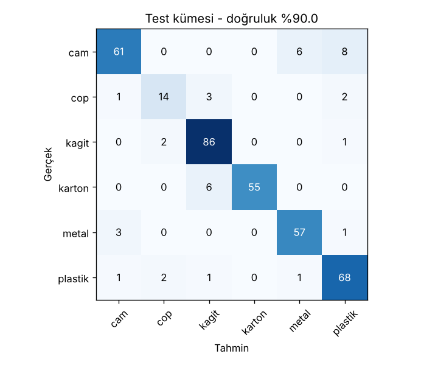
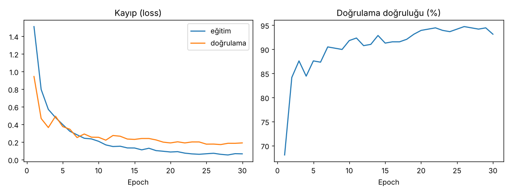

# Atık Sınıflandırma Modeli (YOLOv8n-cls)

*Waste image classifier for my smart recycling bin project. YOLOv8n-cls fine-tuned on TrashNet (2,527 images, 6 classes): 89.97% accuracy on a held-out test set, 91.56% when mapped to the bin's 5 compartments, ~9 ms per image on CPU. A HOG + colour histogram + SVM baseline reaches 70.45%.*

[Akıllı Atık Ayrıştırma Kutusu](https://github.com/UBKc/akilli-atik-ayristirma) projemizde atık şu an Gemini API ile tanınıyor. İnternet bağlantısı olmadan, doğrudan Raspberry Pi üzerinde çalışabilecek bir model için bu modeli eğittim. Kendi kutumuzun fotoğraflarından veri seti henüz toplanmadığı için açık bir veri seti olan TrashNet kullandım.



## Veri seti

TrashNet (Gary Thung ve Mindy Yang, Stanford, MIT lisansı): beyaz zemin üzerinde çekilmiş 2.527 atık fotoğrafı.

| Sınıf | Görüntü | Kutudaki bölme |
|---|---|---|
| kağıt | 594 | KAGIT |
| cam | 501 | CAM |
| plastik | 482 | PLASTIK |
| metal | 410 | METAL |
| karton | 403 | KAGIT |
| çöp | 137 | DIGER |

Her sınıf kendi içinde %70 eğitim, %15 doğrulama, %15 test olarak ayrıldı (seed 42). Sonuç: 1.769 eğitim, 379 doğrulama, 379 test görüntüsü. Test kümesi eğitimde ve en iyi epoch'un seçiminde hiç kullanılmadı.

Kutuda karton için ayrı bölme yok, karton kağıt bölmesine gidiyor. Bu yüzden sonuçları hem 6 sınıf hem de kutudaki 5 bölmeye göre verdim.

## Eğitim

- Model: YOLOv8n-cls, ImageNet ağırlıklarıyla başlayıp ince ayar (1,44 milyon parametre). Raspberry Pi'de çalışacağı için en küçük model seçildi.
- Giriş boyutu 224, batch 32, 30 epoch. Veri artırma Ultralytics'in varsayılanları: RandAugment, yatay çevirme, renk değişimi, rastgele silme.
- Eğitim GPU olmadan, 2 çekirdekli işlemcide yapıldı (epoch başına yaklaşık 1 dakika).
- En iyi doğrulama doğruluğu 26. epoch'ta %94,72, bu epoch'un ağırlıkları kullanıldı.



## Sonuçlar (test kümesi, 379 görüntü)

| Yöntem | 6 sınıf | Kutudaki 5 bölme |
|---|---|---|
| HOG + renk histogramı + SVM | %70,45 | %73,09 |
| **YOLOv8n-cls** | **%89,97** | **%91,56** |

Doğrulama doğruluğu (%94,72) testten yüksek, çünkü en iyi epoch doğrulama kümesine bakılarak seçildi. Asıl başarı test kümesindeki değer.

### Sınıf bazında (YOLOv8n-cls)

| Sınıf | Kesinlik | Duyarlılık | F1 |
|---|---|---|---|
| kağıt | 0,896 | 0,966 | 0,930 |
| karton | 1,000 | 0,902 | 0,948 |
| metal | 0,891 | 0,934 | 0,912 |
| plastik | 0,850 | 0,932 | 0,889 |
| cam | 0,924 | 0,813 | 0,865 |
| çöp | 0,778 | 0,700 | 0,737 |

- **En çok cam karışıyor:** 75 cam görüntüsünün 8'i plastik, 6'sı metal tahmin edildi. Şeffaf cam şişe ile plastik şişe, parlak cam ile metal kutu görüntüde birbirine benziyor.
- **Karton ile kağıt:** 6 karton kağıt olarak tahmin edildi. İkisi de aynı bölmeye gittiği için kutu açısından hata değil, 5 bölmede doğruluğun yükselmesinin sebebi bu.
- **Çöp sınıfı en zayıf:** sadece 137 görüntü var ve içinde çok farklı nesneler bulunuyor.

Ortalama tahmin süresi işlemcide (2 çekirdek, Intel Xeon 2.1 GHz) görüntü başına yaklaşık 9 ms. Raspberry Pi'de daha yavaş olacak, orada henüz ölçmedim.

Klasik yöntemde görüntü 128x96'ya küçültülüp HOG (şekil) ve HSV renk histogramı çıkarıldı, SVM'in C ve gamma değerleri doğrulama kümesine göre seçildi.

## Dosyalar

| Dosya | Ne işe yarıyor |
|---|---|
| `veri_hazirla.py` | TrashNet'i eğitim / doğrulama / test olarak ayırıyor, sınıf adlarını Türkçeye çeviriyor |
| `egit.py` | YOLOv8n-cls ince ayar |
| `degerlendir.py` | test kümesinde doğruluk, sınıf bazında sonuçlar, karışıklık matrisi, süre |
| `klasik_yontem.py` | karşılaştırma için HOG + renk histogramı + SVM |
| `egitim_grafigi.py` | kayıp ve doğruluk grafiği |
| `tahmin.py` | tek fotoğraf için tahmin ve kutu bölmesi |
| `kutu_eslestirme.py` | 6 sınıfı kutudaki 5 bölmeye eşleme |
| `model/atik_yolov8n_cls.pt` | eğitilmiş model (3 MB) |
| `sonuclar/` | test sonuçları (json), eğitim sonuçları (csv), grafikler |

## Çalıştırma

```
pip install -r requirements.txt
```

Sadece tahmin için:

```
python tahmin.py foto.jpg
```

Eğitimi baştan yapmak için TrashNet'teki `data/dataset-resized.zip` dosyası ([github.com/garythung/trashnet](https://github.com/garythung/trashnet)) `ham/` klasörüne açılmalı:

```
python veri_hazirla.py ham/dataset-resized
python egit.py
python degerlendir.py runs/classify/calismalar/yolov8n_cls/weights/best.pt
python klasik_yontem.py
```

## Eksikler

- TrashNet fotoğrafları beyaz zeminde, iyi ışıkta ve tek nesneyle çekilmiş. Kutunun içindeki kamerada arka plan, ışık ve açı farklı olacağı için gerçek başarı daha düşük çıkabilir. Kendi kutumuzdan fotoğraf toplayıp modeli onlarla da eğitmek gerekiyor.
- Model henüz kutunun Raspberry Pi'sinde denenmedi.
- Çöp sınıfı için daha fazla örnek gerekiyor.

## Lisans

AGPL-3.0 (Ultralytics YOLO kullanıldığı için). TrashNet veri seti MIT lisanslı, repoya eklenmedi.
